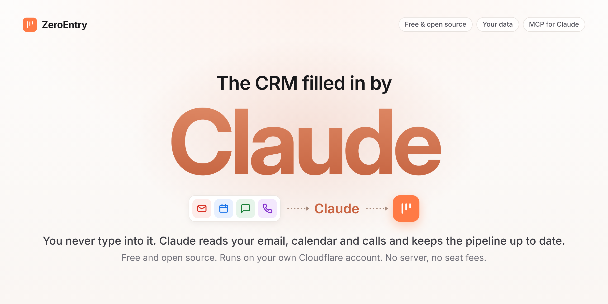
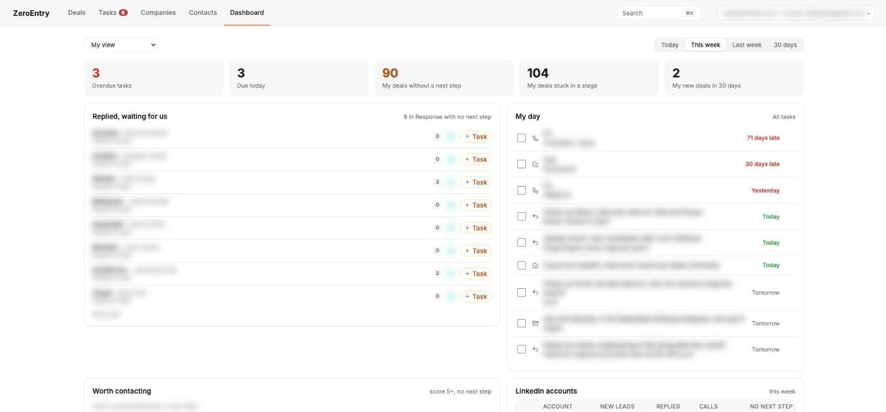

# ZeroEntry CRM

ZeroEntry is a free CRM that runs on your own Cloudflare account. Claude reads your email, calendar and call notes and keeps the pipeline up to date, so you rarely type into it yourself.

Our sales team at [Hiretop](https://hiretop.com) moved to ZeroEntry after about eight years on Pipedrive. It holds our real data: 5,212 deals and 5,200 people.

The code is not public yet. This repository is a preview: screenshots, what the CRM does and how fast it is. We will publish the code here. Watch or star the repository to hear when it lands.

## Why we built it

We wanted the CRM connected directly to two tools we use every day: Claude, and [Realtimer](https://realtimer.ai), our AI assistant for sales calls.

ZeroEntry is an MCP server, so Claude can read and change it. I ask "which of my deals have no next step?" or "add a task to call Acme tomorrow at 11" in plain words, and the answer or the change comes straight from the CRM. Realtimer works with the same CRM.

We're Pipedrive fans, so the interface will feel familiar, though nothing in it is copied. We built it around the fields our team uses.

## Screenshots

Client names and details are blurred.

## What it does

The basics: a pipeline board with drag and drop, deals, people, companies, tasks, notes and the full change history on every record.

What we added for our own team:

| Feature | What it does |
|---|---|
| Claude connection (MCP) | The CRM is an MCP server with 14 tools, so Claude can read it and change it in plain words: find deals, add leads, log emails, create and close tasks, move stages, save lead scores. Every change goes into the record's history under your name. OAuth for the Claude apps, API keys for Claude Code. |
| Realtimer connection | Realtimer, our AI assistant for sales calls, saves the text of each call to your Realtimer account (Pro plan, no audio). Claude reads the call through the Realtimer connector and updates the deal in ZeroEntry: a summary note, the next steps as tasks, the stage if it changed. |
| Lead score | A system that reads hiring signals. Claude researches each lead on the web and in the CRM, scores it from 0 to 9 with our rules and writes the angle for the first message. It runs as a Claude skill or as one detailed prompt, and on request it turns the best leads into tasks for the team. |
| New lead in one window | Paste a LinkedIn link: the CRM fills in the name, warns about duplicates and creates the company, person, deal and first task. |
| LinkedIn accounts | Built for LinkedIn outreach from many profiles. One SDR can run several LinkedIn accounts: every deal and task keeps the profile the conversation runs from, and you can work one profile at a time. |
| LinkedIn chats import | Turn every conversation in a LinkedIn profile into deals and tasks, using the data export LinkedIn itself gives every member. Nobody shares a password or installs an extension, and nothing logs into the profile, so there is no bot activity for LinkedIn to flag. |
| Email logging by BCC | BCC the CRM's address and the email lands on the right person, company and open deal. |
| Undo instead of "Are you sure?" | Changes happen at once, and you have 8 seconds to undo them. |
| Duplicate people | Finds people with the same LinkedIn, email, or name at the same company, and merges them. |
| Keyboard shortcuts | N for a new lead, T for a task, D to mark a task done. They work on the Ukrainian keyboard layout too. |
| Jobs and candidates | Each job has its own candidate pipeline, for recruitment teams. |
| Import | CSV import that matches Pipedrive and HubSpot export columns. |
| REST API | API keys for n8n, Make or your own scripts, with upsert to avoid duplicates. |

### Claude and Realtimer

Connecting the CRM to Claude was the main reason we built ZeroEntry. Connect it in Claude (Settings, Connectors, Add custom connector), sign in, and Claude works with the CRM as you, with your role: a viewer can only read.

Claude has 14 tools here. It can search deals, people and companies, list deals by stage, owner or LinkedIn profile, read a whole deal with its history, create deals and leads, update people and companies, add notes, log emails, and create, list and close tasks. Typical requests:

- "Which of my deals have no next step?"
- "Add a task to call Acme tomorrow at 11."
- "Log my last email from Maria to her deal."
- "Score the new deals from this week and create tasks for the best ones."

Claude reads your mail and calendar with its own Gmail and Google Calendar connectors and writes the result here. Emails are matched by message id and calendar events by event id, so a daily run does not create duplicates. Every change Claude makes shows in the record's history under your name, and the changes you make in the app can be undone for 8 seconds.

Realtimer is the AI assistant our team uses on sales calls. On the Pro plan it saves the text of each call to your Realtimer account by default (never the audio, and you can turn it off), and it has its own connector for Claude. With both connected, one request covers the whole follow-up: "Read my call with Northwind and update the deal." Claude finds the call, adds a summary note, turns the agreed next steps into tasks with dates and moves the deal if the stage changed. Realtimer never sends emails; Claude can draft the follow-up for you to check and send.

### Built for LinkedIn outreach from many profiles

Our sales team runs outreach campaigns on LinkedIn from 15 profiles, and one SDR runs two of them. ZeroEntry was built for that way of working: 622 deals in our CRM carry the profile they came from.

What it looks like in the CRM:

- Each deal is tied to the LinkedIn profile the conversation runs from. The deal page shows "via" and the profile, with a link that opens it, so you always know which account to answer from.
- A new lead takes one window: paste the LinkedIn link, pick the profile, and the CRM creates the company, person, deal and first task under that profile.
- Tasks take the profile of their deal, so an SDR can finish one profile's tasks before switching to the next.
- The dashboard has a row per profile for the week: new leads, replies, calls and deals with no next step. Click a row and the board shows only that profile's deals.
- Profiles live in Settings, with the number of deals on each and a switch to turn off the ones you no longer use. When you paste LinkedIn chats, the CRM lists the senders who are not leads so you can add them as profiles, and one button fills in the profile on older deals from their chats.
- Claude works by profile through the CRM connector. Ask for the open deals or today's tasks on one profile, or import every conversation from a profile as new deals and tasks.

### LinkedIn chats import without touching the profile

Most LinkedIn automation tools need your login or a browser extension that clicks for you. LinkedIn's User Agreement does not allow bots, scrapers or extensions that automate activity on the site, and accounts can be restricted for using them. We wanted every conversation in the CRM without putting a profile at risk.

ZeroEntry uses the export that LinkedIn offers every member. The profile owner opens Settings & Privacy, then Data privacy, then Get a copy of your data, and downloads the archive. It has every conversation in one messages.csv file. Claude reads that file and, through the CRM connector, creates a deal for each lead with the person, the company, a short summary of the conversation, the profile it came from and a follow-up task.

Nobody gets the profile's password, nothing runs inside LinkedIn, and the profile owner decides what to hand over. In November 2026 we brought in 408 deals this way from four of our profiles.

### Lead scoring

Lead scoring is our hiring rules plus research, and Claude does the research. For each deal it reads the history in the CRM: what the person replied, when, and whether we already work with the company. Then it searches the web for signals: open engineering roles and when they were posted, funding rounds, headcount, where the company is based, layoffs. A role posted in the last 60 days or a round from the last 90 days adds points. An older one adds nothing, so a company that hired last year does not look hot today. Agencies, non-profits and teams under 4 people are rejected outright.

The result goes on the deal: a score from 0 to 9, a verdict, the facts with dates and sources, the angle for the first message and the main risk. Anyone on the team can run it from the CRM settings, as a Claude skill or as one detailed prompt. When you ask, Claude also turns the best leads into follow-up tasks for the deal owners.

In one week of November 2026 it scored 31 new deals. One scored as a maybe, five had open engineering roles, three were agencies, and most of the rest were old LinkedIn conversations with nothing fresh behind them.

## Speed

I timed ZeroEntry and Pipedrive on the same laptop, in Chrome, on the same network and the same day. Each screen was opened 12 times; the tables show the median.

| Screen | ZeroEntry | Pipedrive |
|---|---|---|
| Deals board | 0.23 s | 0.50 s |
| A deal | 0.18 s | 0.59 s |
| A person | 0.28 s | 0.74 s |
| A company | 0.33 s | 0.61 s |
| People list | 0.19 s | 0.26 s |

Going back to a screen you already opened takes 0.01 to 0.05 s in ZeroEntry, because it shows the page it has and checks for changes in the background. In Pipedrive it takes about as long as the first time.

This was one test on one laptop, so treat it as a rough guide. The full test is on Medium: [We replaced Pipedrive with our own CRM. Then I timed both.](https://medium.com/@andrii.ryzhenko/we-replaced-pipedrive-with-our-own-crm-then-i-timed-both-fac7d963c2cd)

## How it runs

- Cloudflare Workers for the server, D1 (SQLite) for the database.
- Sign-in through Cloudflare Access: Google, GitHub or a code sent by email. The CRM stores no passwords.
- Roles: admin, member, viewer.
- Plain JavaScript front end with no build step.
- A small team fits in Cloudflare's free plan, so there are no seat fees. Once you have a few thousand deals, take the Workers Paid plan: $5 a month for the whole account, not per user. It lifts the free plan's limits of 10 ms of CPU per request and 5 million database rows read per day, so big lists, imports and merges do not stop halfway.

## Get it

ZeroEntry is free. If you use [Realtimer](https://realtimer.ai), we will install ZeroEntry for you and move your data over for free.

Have a question, or want early access? [Open an issue](../../issues).
