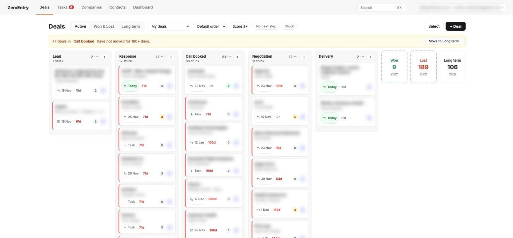

# ZeroEntry CRM

ZeroEntry is a free CRM that runs on your own Cloudflare account. Claude reads your email, calendar and call notes and keeps the pipeline up to date, so you rarely type into it yourself.

Our sales team at [Hiretop](https://hiretop.com) moved to ZeroEntry after about eight years on Pipedrive. It holds our real data: 5,212 deals and 5,200 people.

The code is not public yet. This repository is a preview: screenshots, what the CRM does and how fast it is. We will publish the code here. Watch or star the repository to hear when it lands.

## Why we built it

We wanted the CRM connected directly to two tools we use every day: Claude, and [Realtimer](https://realtimer.ai), our AI assistant for sales calls.

ZeroEntry is an MCP server, so Claude can read and change it. I ask "which of my deals have no next step?" or "add a task to call Acme tomorrow at 11" in plain words, and the answer or the change comes straight from the CRM. Realtimer works with the same CRM.

We're Pipedrive fans, so the interface will feel familiar, though nothing in it is copied. We built it around the fields our team uses.

## Screenshots

Client names and details are blurred.

## What it does

The basics: a pipeline board with drag and drop, deals, people, companies, tasks, notes and the full change history on every record.

What we added for our own team:

| Feature | What it does |
|---|---|
| Claude connection (MCP) | Claude reads and writes the CRM. OAuth for the Claude apps, API keys for Claude Code. |
| Realtimer connection | Our AI assistant for sales calls works with the same CRM. |
| Lead score | Every lead gets a score from 0 to 9 and the angle for the first message. |
| New lead in one window | Paste a LinkedIn link: the CRM fills in the name, warns about duplicates and creates the company, person, deal and first task. |
| LinkedIn account on each deal | Shows which of our LinkedIn profiles the conversation came from. |
| LinkedIn chats import | Pull every conversation from a LinkedIn profile and turn them into new deals and tasks. |
| Email logging by BCC | BCC the CRM's address and the email lands on the right person, company and open deal. |
| Undo instead of "Are you sure?" | Changes happen at once, and you have 8 seconds to undo them. |
| Duplicate people | Finds people with the same LinkedIn, email, or name at the same company, and merges them. |
| Keyboard shortcuts | N for a new lead, T for a task, D to mark a task done. They work on the Ukrainian keyboard layout too. |
| Jobs and candidates | Each job has its own candidate pipeline, for recruitment teams. |
| Import | CSV import that matches Pipedrive and HubSpot export columns. |
| REST API | API keys for n8n, Make or your own scripts, with upsert to avoid duplicates. |

## Speed

I timed ZeroEntry and Pipedrive on the same laptop, in Chrome, on the same network and the same day. Each screen was opened 12 times; the tables show the median.

| Screen | ZeroEntry | Pipedrive |
|---|---|---|
| Deals board | 0.23 s | 0.50 s |
| A deal | 0.18 s | 0.59 s |
| A person | 0.28 s | 0.74 s |
| A company | 0.33 s | 0.61 s |
| People list | 0.19 s | 0.26 s |

Going back to a screen you already opened takes 0.01 to 0.05 s in ZeroEntry, because it shows the page it has and checks for changes in the background. In Pipedrive it takes about as long as the first time.

This was one test on one laptop, so treat it as a rough guide. The full test is on Medium: [We replaced Pipedrive with our own CRM. Then I timed both.](https://medium.com/@andrii.ryzhenko/we-replaced-pipedrive-with-our-own-crm-then-i-timed-both-fac7d963c2cd)

## How it runs

- Cloudflare Workers for the server, D1 (SQLite) for the database.
- Sign-in through Cloudflare Access: Google, GitHub or a code sent by email. The CRM stores no passwords.
- Roles: admin, member, viewer.
- Plain JavaScript front end with no build step.
- A small team fits in Cloudflare's free plan, so there are no seat fees.

## Get it

ZeroEntry is free. If you use [Realtimer](https://realtimer.ai), we will install ZeroEntry for you and move your data over for free.

Have a question, or want early access? [Open an issue](../../issues).
