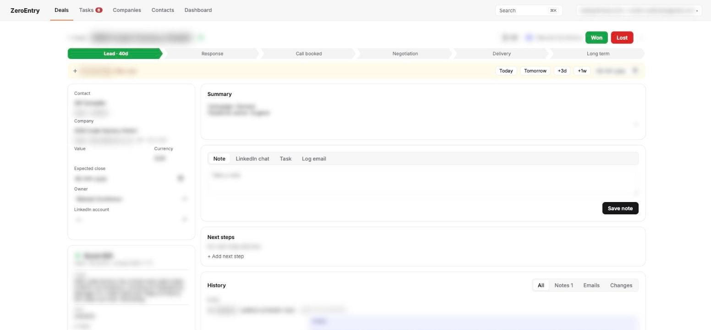
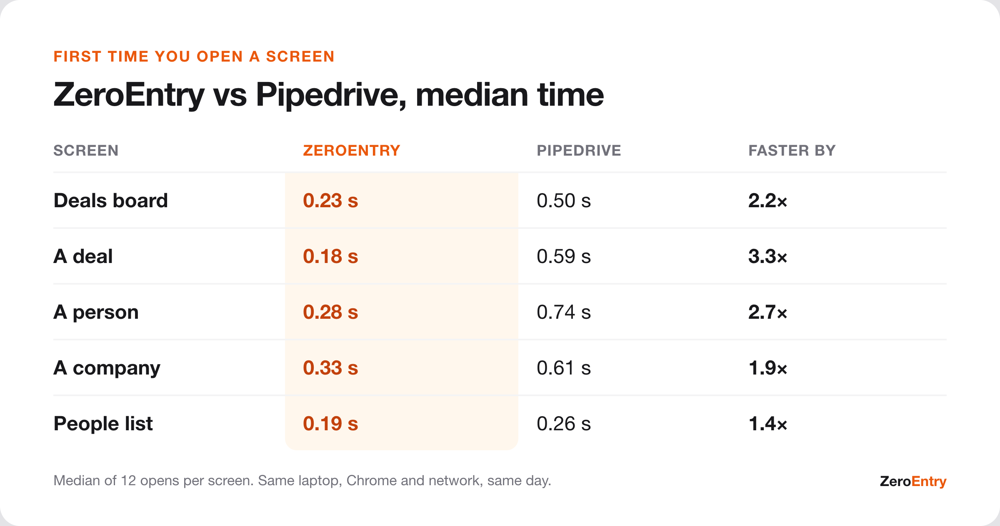
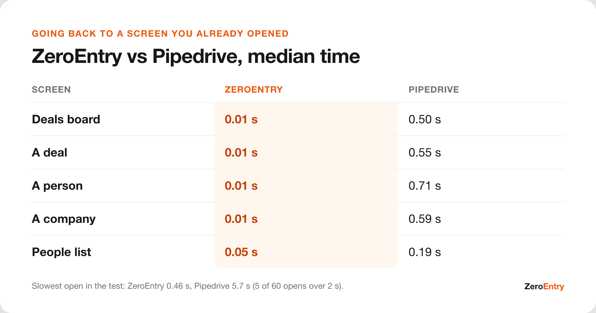

# ZeroEntry CRM

**The open source CRM that Claude fills in.** Built for B2B teams that sell on LinkedIn and already use Claude.

> The code is not public yet. Star this repo, or click Watch → Custom → Releases, to hear when it lands. Want it sooner? [Ask for early access](../../issues/new?template=early-access.yml).

ZeroEntry is a free CRM that runs on your own Cloudflare account. Claude reads your email, calendar and call notes and keeps the pipeline up to date, so you rarely type into it yourself.

Our sales team at [Hiretop](https://hiretop.com) moved to ZeroEntry after about eight years on Pipedrive. It holds our real data: 5,212 deals and 5,200 people.

## Who it's for

- Small B2B sales and recruitment teams that write to leads on LinkedIn, often from several profiles.
- Teams that already use Claude and want it to read and update the CRM for them.
- Anyone leaving Pipedrive or HubSpot who wants the data in their own account and no seat fees.

It is not for you if you need marketing automation, built-in calling or invoicing. ZeroEntry covers the pipeline, people, companies, tasks and history, plus the three things below.

## What makes it different

### 1. Claude works inside the CRM

Connecting the CRM to Claude was the main reason we built ZeroEntry. It is an MCP server with 14 tools: add it in Claude (Settings, Connectors, Add custom connector), sign in, and Claude reads and changes the CRM as you, with your role. You ask in plain words:

- "Which of my deals have no next step?"
- "Add a task to call Acme tomorrow at 11."
- "Log my last email from Maria to her deal."
- "Read my call with Northwind and update the deal."

Claude reads your mail and calendar with its own Gmail and Google Calendar connectors and writes the result here. Emails are matched by message id and calendar events by event id, so a daily run does not create duplicates. Every change shows in the record's history under your name.

The last request uses [Realtimer](https://realtimer.ai), our AI assistant for sales calls. On the Pro plan it saves the text of each call (never the audio), and Claude reads it through the Realtimer connector: it adds a summary note, turns the agreed next steps into tasks with dates and moves the deal if the stage changed.

### 2. Built for LinkedIn outreach from many profiles

Our team writes to leads from 15 LinkedIn profiles, and one SDR runs two of them. In ZeroEntry every deal and task keeps the profile the conversation runs from, with a link that opens it. The dashboard has a row per profile for the week (new leads, replies, calls, deals with no next step), and one click shows only that profile's deals.

Getting the conversations in does not touch the profile. LinkedIn's User Agreement does not allow bots, scrapers or extensions that automate the site, and accounts can be restricted for using them. ZeroEntry uses the export LinkedIn gives every member instead: the profile owner downloads it (Settings & Privacy, Data privacy, Get a copy of your data), and Claude turns messages.csv into deals with the person, the company, a summary of the conversation and a follow-up task. Nobody shares a password and nothing runs inside LinkedIn. In November 2026 we brought in 408 deals this way from four profiles.

### 3. Lead scoring with fresh signals

Claude scores each deal from 0 to 9. It reads the history in the CRM, then searches the web for signals: open engineering roles and when they were posted, funding, headcount, HQ country, layoffs. A role from the last 60 days or a round from the last 90 adds points; older ones add nothing. The result goes on the deal with the facts, their dates and sources, the angle for the first message and the main risk. On request, Claude turns the best leads into tasks for the deal owners.

The rules are yours. They live in Settings → Claude scoring as a Claude skill and as one prompt, and an admin can edit them there. Ours are written for IT recruitment, so agencies and non-profits are rejected outright; change that for your market.

In one week of November 2026 it scored 31 new deals: one maybe, five with open engineering roles, three agencies, and the rest old conversations with nothing fresh behind them.

## Screenshots

Client names and details are blurred.

## ZeroEntry vs Pipedrive

| | ZeroEntry | Pipedrive |
|---|---|---|
| Price | Free | Paid per user |
| Where your data lives | Your own Cloudflare account | Pipedrive's cloud |
| Code | Open source soon | Closed |
| Opening a screen (median) | 0.18 to 0.33 s | 0.26 to 0.74 s |
| Opening it again | 0.01 to 0.05 s | 0.19 to 0.71 s |
| Slowest open in our test | 0.46 s | 5.7 s |

I timed both on the same laptop, in Chrome, on the same network and the same day, 12 opens per screen. One test on one laptop, so treat it as a rough guide. The full test is on Medium: [We replaced Pipedrive with our own CRM. Then I timed both.](https://medium.com/@andrii.ryzhenko/we-replaced-pipedrive-with-our-own-crm-then-i-timed-both-fac7d963c2cd)

Speed tables by screen

## Everything else

- New lead in one window: paste a LinkedIn link, pick the profile, and the CRM creates the company, person, deal and first task, with a duplicate warning.
- Email logging by BCC: the email lands on the right person, company and open deal.
- Undo instead of "Are you sure?": changes happen at once, and you have 8 seconds to take them back.
- Duplicate people: finds people with the same LinkedIn, email, or name at the same company, and merges them.
- Keyboard shortcuts: N for a new lead, T for a task, D to mark a task done. They work on the Ukrainian layout too.
- Jobs and candidates: each job has its own candidate pipeline, for recruitment teams.
- Import from Pipedrive and HubSpot CSV exports.
- REST API with keys for n8n, Make or your own scripts.

## How it runs

- Cloudflare Workers for the server, D1 (SQLite) for the database.
- Sign-in through Cloudflare Access: Google, GitHub or a code sent by email. The CRM stores no passwords.
- Roles: admin, member, viewer.
- Plain JavaScript front end with no build step.
- A small team fits in Cloudflare's free plan, so there are no seat fees. Once you have a few thousand deals, take the Workers Paid plan: $5 a month for the whole account, not per user. It lifts the free plan's limits of 10 ms of CPU per request and 5 million database rows read per day, so big lists, imports and merges do not stop halfway.

## Roadmap

- [x] Running in production for our sales team
- [x] Claude connection, LinkedIn profiles, lead scoring
- [ ] Public code under an open source license
- [ ] One-click Deploy to Cloudflare
- [ ] Setup guide for teams moving from Pipedrive or HubSpot

## Get early access

ZeroEntry is free. If you use [Realtimer](https://realtimer.ai), we will install ZeroEntry for you and move your data over for free.

[Ask for early access](../../issues/new?template=early-access.yml), or ask a question in [Discussions](../../discussions).
